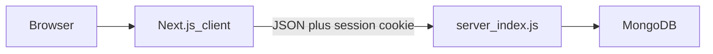
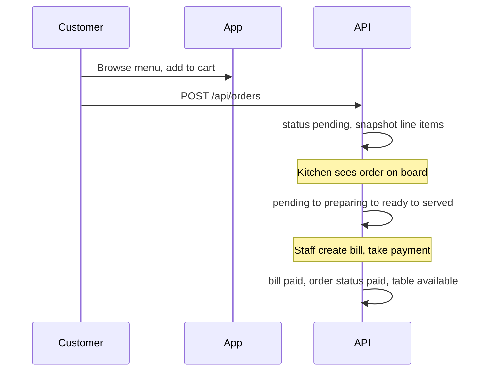

# Architecture

One restaurant. Customers browse the menu, place orders, and book tables. Staff and admins run the floor from a dashboard.

Pages, roles, flows, and collection field details: [features.md](features.md). Execution backlog: [TASKS.md](TASKS.md).

JavaScript only. ESM. No TypeScript, Mongoose, MVC, or extra backend layers. Do not add schema files, Mongoose models, or a `models/` folder; collections are described in features.md and created on first use in MongoDB.

## Stack

| Layer | Choice |
| --- | --- |
| API | Node.js, Express, one file: `server/index.js` |
| Data | MongoDB via official `mongodb` driver (`MongoClient`) |
| Auth | Better Auth (cookie session) |
| UI | Next.js App Router (`.js` / `.jsx`), Tailwind, DaisyUI |

`package.json` on the server uses `"type": "module"`.

## Layout

```
server/index.js                 # entire REST API
client/                         # Next.js (JS only)
  app/
    layout.js                   # root: Navbar, Better Auth session
    page.js                     # /
    globals.css
    menu/page.js
    cart/page.js
    reservations/page.js
    sign-in/page.js
    sign-up/page.js
    account/
      layout.js                 # customer gate
      orders/page.js
      bills/page.js
    dashboard/
      layout.js                 # staff/admin gate + Sidebar
      page.js                   # overview
      menu/page.js
      tables/page.js
      orders/page.js
      reservations/page.js
      billing/page.js
      staff/page.js
  components/
    Navbar.js
    Footer.js
    StatusBadge.js
    MenuCard.js
    CartItem.js
    dashboard/
      Sidebar.js
      StatCard.js
      OrdersBoard.js
      TableCard.js
  lib/
    auth.js                     # Better Auth
    api.js                      # fetch + credentials
    cart.js                     # localStorage cart
    format.js                   # cents ↔ display
  public/
```

Keep `app/` as routes only. Shared UI in `components/` (dashboard-only pieces under `components/dashboard/`). Helpers in `lib/`. Do not add `services/`, `hooks/` (unless a hook is reused), `features/`, or TypeScript.

Do not add `routes/`, `controllers/`, `models/`, or `middleware/` on the server. Group handlers in `index.js` with comments (`// --- MENU ---`).

## Request flow



- Public reads (available menu, home) do not need a session.
- Mutations and dashboard APIs verify the Better Auth session on the Express side. Never trust a client-sent `userId`.
- Responses: `{ ok: true, data }` or `{ ok: false, error }`.

---

## User roles

| Role | Who | Access |
| --- | --- | --- |
| Guest | Not signed in | Home, public menu. Sign in / sign up to order or reserve. |
| `customer` | Diner | Menu, cart, own orders, own reservations, own bills. No `/dashboard`. |
| `staff` | Floor / kitchen | Dashboard: tables, orders board, reservations, billing. Cannot edit menu or staff. |
| `admin` | Manager | Everything staff can, plus menu CRUD and staff accounts. |

Role lives on the user document (`role`). Default new sign-up is `customer`. Only an admin can create or change `staff` / `admin`. Redirect customers away from `/dashboard`; redirect staff/admin from customer-only account pages if needed.

---

## Pages and features

Paths are under `client/app`. Dashboard uses a DaisyUI sidebar/drawer.

### Public and customer

| Page | Path | Features |
| --- | --- | --- |
| Home | `/` | Restaurant intro, hours, CTA to menu and reserve. |
| Menu | `/menu` | Browse available items by category. Guest can view; add-to-cart needs sign-in. |
| Cart | `/cart` | Line items, qty, notes, table number (dine-in) or “takeaway”. Place order. |
| Reservations | `/reservations` | Form: name, party size, datetime. List/cancel own upcoming bookings. |
| My orders | `/account/orders` | Own order list, status, items, link to bill when present. |
| My bills | `/account/bills` | Own bills: unpaid vs paid, totals. Read-only. |
| Sign in | `/sign-in` | Better Auth email/password (and session cookie). |
| Sign up | `/sign-up` | Creates `customer`. |

### Dashboard (staff + admin)

| Page | Path | Features | Roles |
| --- | --- | --- | --- |
| Overview | `/dashboard` | Counts: open orders, occupied tables, tonight’s reservations, unpaid bills. | staff, admin |
| Menu | `/dashboard/menu` | Create/edit/hide items (name, description, price, category, available). | admin |
| Tables | `/dashboard/tables` | Grid of tables; seats; set `available` / `occupied` / `reserved`. | staff, admin |
| Orders board | `/dashboard/orders` | Live list by status. Advance: pending → preparing → ready → served. Cancel when allowed. | staff, admin |
| Reservations | `/dashboard/reservations` | Day list. Confirm, seat (marks table reserved/occupied), no-show, cancel. | staff, admin |
| Billing | `/dashboard/billing` | Create bill from a served order; tax; mark paid cash/card; void. | staff, admin |
| Staff | `/dashboard/staff` | List users with staff/admin role; invite or set role. | admin |

Every list page: loading, empty, and error (DaisyUI `alert`). Use `navbar` + `badge` for status.

---

## Main flows

### Dine-in order



1. Customer signs in, adds available menu items to a client-side cart.
2. Checkout sends `tableId` (or table number) and items. Server snapshots `name` and `price` on each line so later menu edits do not change the order.
3. Staff move status on the orders board. When **served**, table stays `occupied` until the bill is paid.
4. Staff open Billing, create a bill from that order (subtotal from lines, tax, total). Mark **paid** (`cash` | `card`). Order becomes `paid`; table `available`.

### Reservation then seat

1. Customer submits party size + datetime (`/reservations`). Status `pending`.
2. Staff confirm (`confirmed`) and may assign `tableId` (table `reserved` for that slot).
3. Guest arrives: status `seated`, table `occupied`. They order as dine-in.
4. No-show or cancel frees the table.

### Takeaway (optional, same order collection)

Checkout without `tableId`. Same kitchen statuses. Bill can still be created and marked paid. No table status change.

### Admin menu and staff

- Admin adds or hides menu items; customers only see `available: true`.
- Admin sets a user’s `role` to `staff` or `admin` on `/dashboard/staff`.

---

## Collections (fields, no schema files)

Do not create `schema.js`, Mongoose models, or JSON schema files. Validate required fields in the Express handler. Use MongoDB `_id` (`ObjectId`). Store money as a number in **cents** (integer) to avoid float errors. Add `createdAt` / `updatedAt` (ISO date) on writes.

Suggested unique indexes later (in `index.js` on startup, not a separate file): `tables.number`, `users.email`.

### `users`

Better Auth owns credentials/session. App fields we care about:

| Field | Notes |
| --- | --- |
| `_id` | User id on orders, reservations, bills |
| `name`, `email` | From Better Auth |
| `role` | `customer` \| `staff` \| `admin` |
| `createdAt` | |

Staff “collection” is not separate: `/api/staff` is `users` filtered by `role` in `staff` or `admin`.

### `menuItems`

| Field | Notes |
| --- | --- |
| `name` | Required |
| `description` | Short text |
| `price` | Integer cents |
| `category` | String, e.g. `starters`, `mains`, `drinks`, `desserts` (no extra categories collection) |
| `available` | Boolean; public menu filters `true` |
| `imageUrl` | Optional |
| `createdAt`, `updatedAt` | |

### `tables`

| Field | Notes |
| --- | --- |
| `number` | Unique floor number (1, 2, …) |
| `seats` | Capacity; reservations should not exceed this |
| `status` | `available` \| `occupied` \| `reserved` |

No floor-plan coordinates in v1.

### `orders`

| Field | Notes |
| --- | --- |
| `userId` | Customer who placed it (optional for walk-in if staff place the order) |
| `tableId` | Set for dine-in; omit for takeaway |
| `placedBy` | `customer` \| `staff` |
| `items` | Array of `{ menuItemId, name, price, qty, notes }` — price/name copied at order time |
| `status` | See transitions below |
| `subtotal` | Sum of `price * qty` (cents) |
| `notes` | Order-level note |
| `createdAt`, `updatedAt` | |

**Status transitions:** `pending` → `preparing` → `ready` → `served` → `paid`. From `pending` or `preparing`, allow `cancelled`. Do not skip forward except admin/staff explicit actions. `paid` is set when the bill is marked paid, not by the kitchen.

No `orderItems` collection; lines live on the order.

### `reservations`

| Field | Notes |
| --- | --- |
| `userId` | Logged-in customer; staff-created walk-in may omit |
| `guestName`, `guestPhone` | Phone optional |
| `partySize` | Number |
| `datetime` | Reservation slot |
| `tableId` | Assigned on confirm or seat; optional while `pending` |
| `status` | `pending` \| `confirmed` \| `seated` \| `cancelled` \| `no_show` |
| `notes` | |
| `createdAt`, `updatedAt` | |

v1: no automatic conflict engine. Staff should not assign two confirmed reservations to the same table at overlapping times; a later check in the handler can reject obvious overlaps.

### `bills`

| Field | Notes |
| --- | --- |
| `orderId` | One bill per order (unique `orderId`) |
| `userId`, `tableId` | Copied from the order if present |
| `lines` | Copy of order items at billing time (or derive from order; storing a copy keeps the receipt stable) |
| `subtotal`, `tax`, `total` | Cents. Tax rate can be a constant in `index.js` (e.g. 10%) |
| `method` | `cash` \| `card` when paid; empty while unpaid |
| `status` | `unpaid` \| `paid` \| `void` |
| `paidAt` | Set when marked paid |
| `createdAt`, `updatedAt` | |

No Stripe. Staff record that payment happened.

---

## API (`server/index.js`)

| Group | Examples | Who |
| --- | --- | --- |
| Auth | Better Auth routes (Next and/or Express per setup) | public sign-in/up |
| Menu | `GET/POST/PATCH/DELETE /api/menu` | GET available: public. Writes: admin |
| Tables | `GET/POST/PATCH /api/tables` | staff, admin (`POST` seed/add table: admin) |
| Orders | `GET/POST /api/orders`, `PATCH /api/orders/:id/status` | customer: own. staff/admin: all; staff may `POST` walk-in |
| Reservations | `GET/POST/PATCH /api/reservations` | customer: own. staff/admin: all |
| Staff | `GET/PATCH /api/staff` | admin |
| Bills | `GET/POST /api/bills`, `PATCH /api/bills/:id/pay` | customer: own GET. staff/admin: create, pay, void |

Env: `MONGODB_URI`, `DB_NAME`, `PORT`, Better Auth secret, optional `CLIENT_ORIGIN` for CORS/cookies. Do not commit secrets. CORS must allow the Next origin with credentials.

Cart is **client-only** (React state or `localStorage`) until `POST /api/orders`.

---

## UI notes

DaisyUI: `navbar`, `drawer`, `card`, `table`, `modal`, `btn`, `badge`, form controls. Theme via `data-theme`. Fetch Express with `credentials: "include"`.

---

## Out of scope (v1)

- Schema files, MVC, TypeScript, Mongoose
- Stripe / online card capture
- Multi-tenant / multiple restaurants
- Inventory, recipes, payroll, delivery tracking
- Real-time sockets (poll the orders board on an interval)
