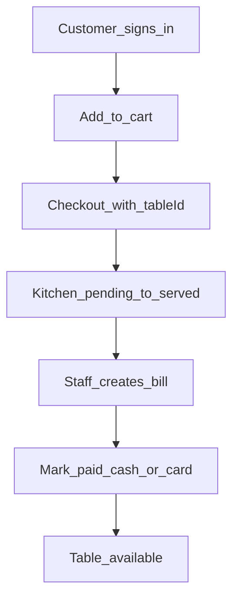

# Features

Product detail for the restaurant app. Stack, **client folder map**, and HTTP API live in [architecture.md](architecture.md). Implementation backlog (user stories, sub-tasks, status): [TASKS.md](TASKS.md). This file covers **pages**, **roles**, **flows**, and **collection fields**. No schema files, models folder, or Mongoose.

Money is integer **cents**. Cart stays in the browser until `POST /api/orders`.

---

## Roles

| | Guest | Customer | Staff | Admin |
| --- | --- | --- | --- | --- |
| View public menu / home | yes | yes | yes | yes |
| Sign in / sign up | yes | — | — | — |
| Cart, place order | | yes | walk-in on dashboard | walk-in on dashboard |
| Own reservations | | yes | all on dashboard | all |
| Own orders / bills (read) | | yes | all | all |
| Tables, orders board, billing | | | yes | yes |
| Menu CRUD | | | | yes |
| Set user roles / staff list | | | | yes |
| `/dashboard` | no | no | yes | yes |

- Sign-up always creates `role: "customer"`.
- `role` is stored on `users`. Staff is not a separate collection.
- Only **admin** may set `staff` or `admin`.
- Session user id from Better Auth; never take `userId` from the body for authorization.
- Unauthenticated visits to `/cart`, `/reservations`, `/account/*` go to `/sign-in`.
- Customers hitting `/dashboard` redirect to `/`. Staff/admin may use the public site too.

---

## Pages

DaisyUI: `navbar`, `drawer` (dashboard), `card`, `table`, `modal`, `btn`, `badge`, forms. Every list: loading, empty, error `alert`.

### Public and customer (`client/app`)

**Home `/`**  
Name, short pitch, hours, buttons to Menu and Reserve.

**Menu `/menu`**  
Available items only (`available: true`), grouped by `category`. Card: name, description, price. **Add to cart** if signed in; otherwise link to sign-in. Guests can still read the menu.

**Cart `/cart`** (customer)  
Qty steppers, per-line notes, remove. Choose dine-in (`tableId` from open tables) or takeaway (no table). Order notes. **Place order** → `POST /api/orders`, clear cart, go to `/account/orders`. Block empty cart and dine-in without a table.

**Reservations `/reservations`** (customer)  
Form: `guestName`, `guestPhone` (optional), `partySize`, `datetime`, notes. Submit → `pending`. List upcoming own reservations; **Cancel** if `pending` or `confirmed`.

**My orders `/account/orders`** (customer)  
Own orders, newest first. Badge for status. Expand items. Link to bill when one exists.

**My bills `/account/bills`** (customer)  
Read-only: `unpaid` / `paid` / `void`, totals, method if paid. No self-pay in v1.

**Sign in `/sign-in`**, **Sign up `/sign-up`**  
Better Auth email/password. Sign-up → customer. After auth, return to the page they wanted (cart or reservations).

### Dashboard (`client/app/dashboard`) — staff and admin

Sidebar: Overview, Orders, Tables, Reservations, Billing, Menu (admin), Staff (admin).

**Overview `/dashboard`**  
Counts: orders not yet `served`/`paid`/`cancelled`; tables `occupied`; reservations today `pending`/`confirmed`; bills `unpaid`.

**Menu `/dashboard/menu`** (admin)  
Table of all items including hidden. Modal to create/edit: name, description, price (display dollars, store cents), category, `available`, optional `imageUrl`. Hide via `available: false` (prefer over delete). Delete only if unused, or just hide.

**Tables `/dashboard/tables`**  
Card/grid per table: number, seats, status badge. Actions: available, occupy, reserve. Admin: add table (number + seats). Occupied until bill paid or staff frees it.

**Orders `/dashboard/orders`**  
Columns or tabs: `pending` | `preparing` | `ready` | `served`. Show table or “takeaway”, items, notes, time. Buttons only for **next** legal status + **Cancel** from `pending`/`preparing`. `paid` appears after billing, not as a kitchen button. Poll every ~5s (no sockets in v1).

**Reservations `/dashboard/reservations`**  
Filter by day. Confirm, assign `tableId` (table → `reserved`), Seat (reservation `seated`, table `occupied`), No-show, Cancel. Walk-in: staff create reservation or occupy a table and place an order.

**Billing `/dashboard/billing`**  
Served orders with no bill: **Create bill** (copy lines, tax from constant in `index.js`, total). Unpaid list: **Pay** cash or card. **Void** unpaid by mistake. Paying sets order `paid` and table `available`.

**Staff `/dashboard/staff`** (admin)  
Users with `staff` or `admin`. Change role (`customer` / `staff` / `admin`). Promote an existing user by email; no extra password system.

---

## Flows

### Dine-in



1. Customer adds **available** items; cart is local.
2. `POST /api/orders` with `tableId` and items. Server copies `name` and `price` onto each line, sets `subtotal`, `status: pending`, `placedBy: customer`. Set table `occupied` if it was `available` (if `reserved`, occupying is OK when seating).
3. Kitchen: `pending` → `preparing` → `ready` → `served`.
4. Billing: one bill per order. Pay → bill `paid`, `method`, `paidAt`; order `paid`; table `available`.

### Walk-in (staff)

Staff occupy a table → add items on the orders page or a small modal → `POST /api/orders` with `placedBy: staff`, optional `userId`. Same kitchen and billing path.

### Takeaway

Same as dine-in without `tableId`. No table status changes.

### Reservation to seated to order

1. Customer submits `/reservations` → `pending`.
2. Staff confirm; optional `tableId` → table `reserved`.
3. Seat → `seated`, table `occupied`.
4. Order as dine-in with that `tableId`.
5. Cancel / no-show → table `available` if it was reserved for this booking.

v1 overlap: if the same `tableId` already has `confirmed`/`seated` at a close datetime, reject assign/confirm in the handler. No full calendar engine.

### Menu and roles (admin)

- New/hidden items: public `/menu` only shows `available: true`.
- Role change is immediate on next request.

### Order status (enforced in `index.js`)

```
pending → preparing → ready → served → paid
pending → cancelled
preparing → cancelled
```

`paid` only from a successful bill pay. `void` on a bill does not auto-uncancel kitchen state; staff handle the table manually if needed.

---

## Collection fields

Validate in handlers. Collections appear on first insert. Suggested unique indexes **later** in `index.js` startup: `users.email`, `tables.number`, `bills.orderId`. Do not add schema files.

Shared: `_id` (ObjectId), `createdAt`, `updatedAt` (Date) on app documents.

### `users`

Better Auth stores credentials/session. App reads:

| Field | Type | Required | Notes |
| --- | --- | --- | --- |
| `name` | string | yes | Display |
| `email` | string | yes | Unique login |
| `role` | string | yes | `customer` \| `staff` \| `admin` |
| `emailVerified` | boolean | no | If Better Auth provides it |

`/api/staff` = find `{ role: { $in: ["staff", "admin"] } }`.

### `menuItems`

| Field | Type | Required | Notes |
| --- | --- | --- | --- |
| `name` | string | yes | |
| `description` | string | no | |
| `price` | number | yes | Cents, integer ≥ 0 |
| `category` | string | yes | `starters` \| `mains` \| `drinks` \| `desserts` (plain string, no categories collection) |
| `available` | boolean | yes | Default `true` |
| `imageUrl` | string | no | |

### `tables`

| Field | Type | Required | Notes |
| --- | --- | --- | --- |
| `number` | number | yes | Unique floor number |
| `seats` | number | yes | Integer ≥ 1; `partySize` should be ≤ seats when assigning |
| `status` | string | yes | `available` \| `occupied` \| `reserved` |

No x/y map in v1.

### `orders`

| Field | Type | Required | Notes |
| --- | --- | --- | --- |
| `userId` | ObjectId | no | Customer; omit for anonymous walk-in |
| `tableId` | ObjectId | no | Required for dine-in; omit takeaway |
| `placedBy` | string | yes | `customer` \| `staff` |
| `items` | array | yes | Min 1 line; see below |
| `status` | string | yes | `pending` \| `preparing` \| `ready` \| `served` \| `paid` \| `cancelled` |
| `subtotal` | number | yes | Cents; sum of `price * qty` |
| `notes` | string | no | Whole order |

**`items[]`**

| Field | Type | Required | Notes |
| --- | --- | --- | --- |
| `menuItemId` | ObjectId | yes | Original item |
| `name` | string | yes | Snapshot |
| `price` | number | yes | Snapshot cents (unit) |
| `qty` | number | yes | Integer ≥ 1 |
| `notes` | string | no | e.g. no onions |

No `orderItems` collection.

### `reservations`

| Field | Type | Required | Notes |
| --- | --- | --- | --- |
| `userId` | ObjectId | no | Set for customer-made bookings |
| `guestName` | string | yes | |
| `guestPhone` | string | no | |
| `partySize` | number | yes | Integer ≥ 1 |
| `datetime` | Date | yes | Slot start |
| `tableId` | ObjectId | no | Set on confirm/seat |
| `status` | string | yes | `pending` \| `confirmed` \| `seated` \| `cancelled` \| `no_show` |
| `notes` | string | no | |

### `bills`

| Field | Type | Required | Notes |
| --- | --- | --- | --- |
| `orderId` | ObjectId | yes | Unique; one bill per order |
| `userId` | ObjectId | no | Copied from order |
| `tableId` | ObjectId | no | Copied from order |
| `lines` | array | yes | Snapshot of order `items` at bill time |
| `subtotal` | number | yes | Cents |
| `tax` | number | yes | Cents; rate constant in `index.js` (e.g. 10%) |
| `total` | number | yes | `subtotal + tax` |
| `method` | string | no | `cash` \| `card` after pay |
| `status` | string | yes | `unpaid` \| `paid` \| `void` |
| `paidAt` | Date | no | Set when `paid` |

No payment gateway. Staff confirm cash/card happened.

---

## Page → API (quick map)

| Page | Main calls |
| --- | --- |
| `/menu` | `GET /api/menu` |
| `/cart` | `POST /api/orders`, `GET /api/tables` (open tables) |
| `/reservations` | `GET/POST /api/reservations`, `PATCH` cancel |
| `/account/orders` | `GET /api/orders` (own) |
| `/account/bills` | `GET /api/bills` (own) |
| `/dashboard/menu` | `GET/POST/PATCH/DELETE /api/menu` |
| `/dashboard/tables` | `GET/POST/PATCH /api/tables` |
| `/dashboard/orders` | `GET /api/orders`, `PATCH /api/orders/:id/status`, `POST` walk-in |
| `/dashboard/reservations` | `GET/POST/PATCH /api/reservations` |
| `/dashboard/billing` | `GET/POST /api/bills`, `PATCH /api/bills/:id/pay` |
| `/dashboard/staff` | `GET/PATCH /api/staff` |

---

## v1 out of scope

Schema files, sockets, Stripe, inventory, delivery, multi-restaurant, guest checkout without account, customer self-pay.
